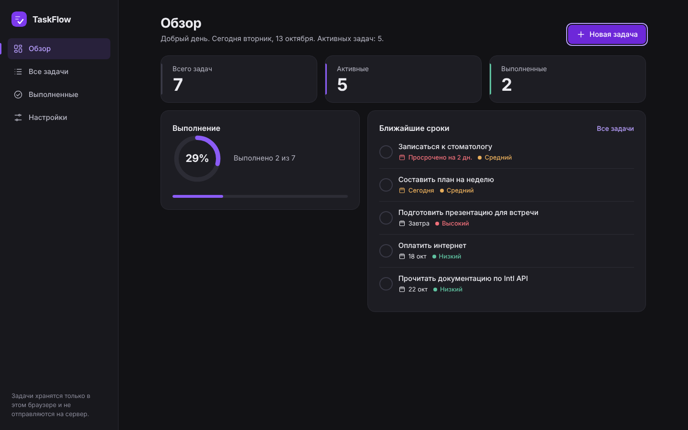
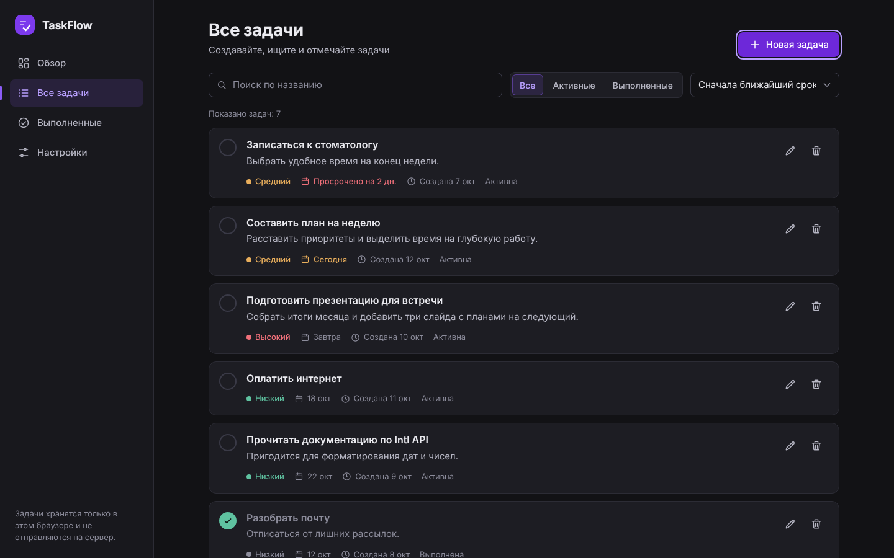
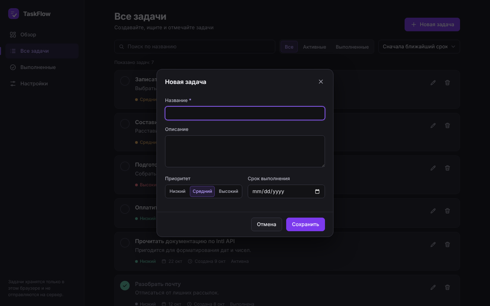
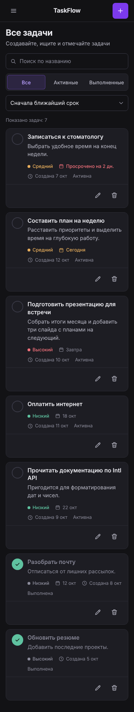

# TaskFlow

Одностраничное веб-приложение для управления личными задачами. Без фреймворков и сборки: чистые HTML, CSS и JavaScript, данные хранятся в браузере.

**Демо:** _после публикации вставьте сюда ссылку на GitHub Pages_



## Скриншоты

| Все задачи | Форма задачи | Мобильная версия |
| --- | --- | --- |
|  |  |  |

Планшетная версия: `docs/screenshots/overview-768.png`, `docs/screenshots/all-768.png`.

## Возможности

- Создание, редактирование и удаление задач (удаление с подтверждением).
- Поля задачи: название, описание, дата создания, срок, приоритет (низкий, средний, высокий), статус.
- Переключение статуса «активная» и «выполненная».
- Фильтр по статусу, сортировка по сроку и по приоритету, поиск по названию.
- Страница «Обзор»: приветствие, статистика, индикатор выполнения и ближайшие сроки.
- Статистика пересчитывается после каждого изменения.
- Сохранение в LocalStorage и восстановление после перезагрузки.
- Пустые состояния, уведомления об успехе и ошибках.
- Валидация формы: название обязательно.
- Адаптивность: десктоп от 1280 px, планшет 768–1279 px, мобильные от 320 px. На экранах уже 1280 px боковая панель сворачивается в выезжающее меню.
- Клавиатурная навигация, видимый фокус, поддержка `prefers-reduced-motion`.

При первом запуске добавляются несколько демонстрационных задач. Их можно удалить в любой момент, а в «Настройках» можно удалить все задачи сразу или добавить демо-набор снова.

## Технологии

HTML5, CSS3 (переменные, grid, flexbox), JavaScript ES2022, LocalStorage, нативный элемент `<dialog>`.

## Запуск

Сборка не нужна. Достаточно открыть `index.html` в браузере.

Либо запустить локальный сервер:

```bash
python3 -m http.server 8000
# затем открыть http://localhost:8000
```

## Структура

```text
taskflow/
├── index.html
├── css/
│   └── style.css
├── js/
│   └── app.js
├── assets/
│   └── icons/
│       └── logo.svg
├── docs/
│   └── screenshots/
├── README.md
└── .gitignore
```

## Публикация на GitHub Pages

```bash
git init
git add .
git commit -m "Initial commit: TaskFlow"
git branch -M main
git remote add origin https://github.com/<ваш-логин>/taskflow.git
git push -u origin main
```

Затем в репозитории: **Settings → Pages → Build and deployment → Source: Deploy from a branch**, ветка `main`, папка `/ (root)`. Через минуту сайт станет доступен по адресу `https://<ваш-логин>.github.io/taskflow/`.

Все пути в проекте относительные, поэтому приложение работает и из подпапки репозитория.

## Формат данных

Данные лежат в LocalStorage под ключом `taskflow:v1`:

```json
{
  "version": 1,
  "userName": "Даня",
  "tasks": [
    {
      "id": "…",
      "title": "Название",
      "description": "",
      "priority": "low | medium | high",
      "status": "active | completed",
      "dueDate": "2026-10-20",
      "createdAt": "2026-10-13T10:00:00.000Z"
    }
  ]
}
```

Некорректные записи при чтении отбрасываются или приводятся к допустимым значениям, поэтому испорченные данные не ломают приложение.
